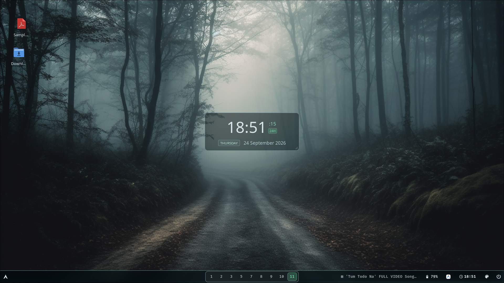
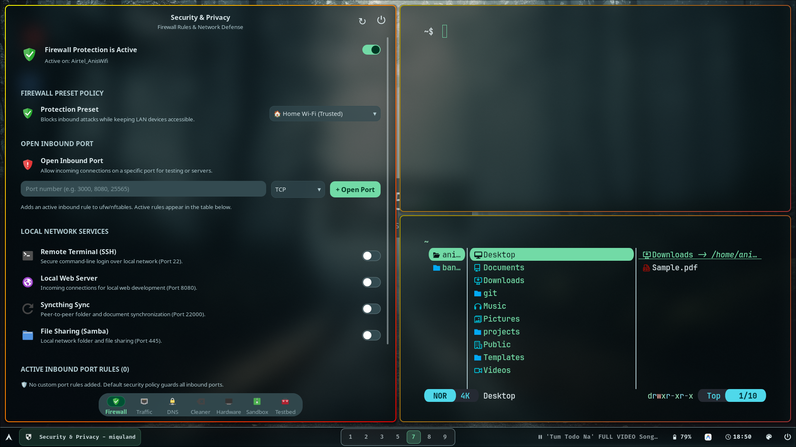
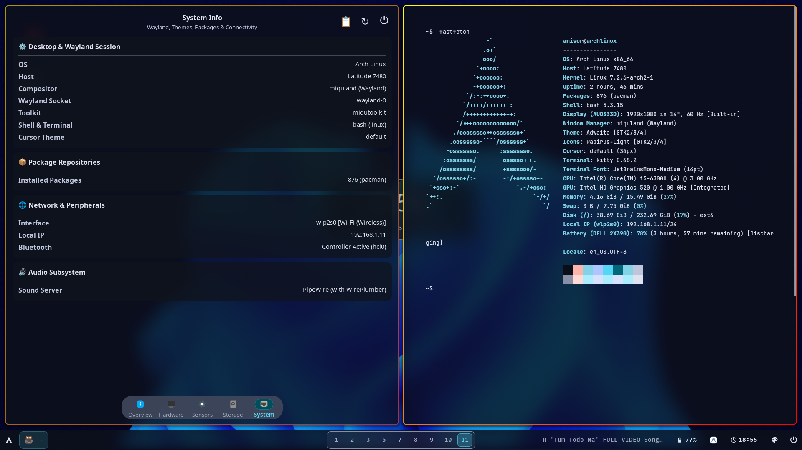
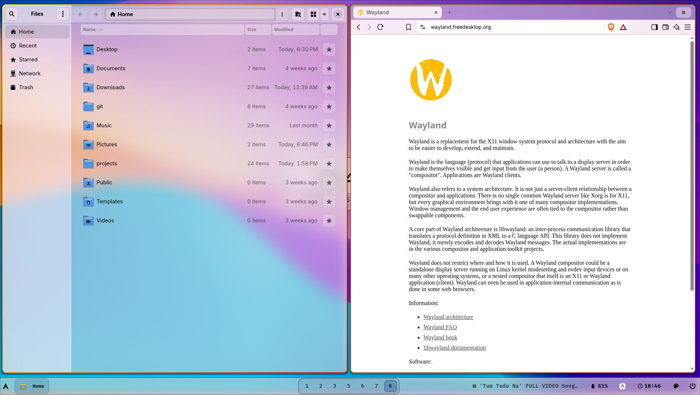
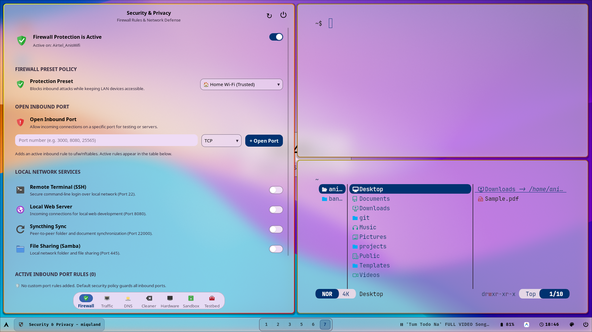

# Miquland

<p align="center">
  <b>Dynamic Tiling Wayland Compositor Built with wlroots & SceneFX</b>
</p>

<p align="center">
  
  
  
  
</p>

---

`miquland` is the core Wayland compositor and window manager for the **Miqu Desktop Ecosystem**. Built on modern C++20, `wlroots`, and `SceneFX`, it delivers high-framerate dynamic tiling, GPU-accelerated window effects (rounded corners, dual-pass blurs, soft drop shadows), protocol-compliant session management, and a native IPC plugin architecture.

---

## ✨ Features & Architecture

* **Dynamic Tiling Layouts**:
  * `spiral`: Alternating horizontal/vertical binary space partitioning (Fibonacci BSP).
  * `stack`: Master-and-stack column layout with adjustable split ratios.
* **GPU-Accelerated Visuals**: Hardware rendering via `SceneFX` supporting real-time window corner rounding, customizable drop shadows, dual-pass Gaussian layer blurs, and border shading.
* **Comprehensive Wayland Protocol Suite**:
  * Layer Shell (`wlr-layer-shell-unstable-v1`) for desktop bars, notifications, and wallpaper surfaces.
  * Session Lock (`ext-session-lock-v1`) for secure screen locking.
  * Idle Management (`ext-idle-notify-v1`) for power and display sleep events.
  * Output Power Management (`wlr-output-power-management-v1`).
* **Self-Contained Configuration Model (Sway Contract)**:
  * **Zero-Config Baseline**: Runs directly from `/usr/share/miquland/miquland.conf` on fresh installs.
  * **On-Demand User Config**: Generates `~/.config/miquland/miquland.conf` via `miquland --init-config`.
  * **Safe Archiving**: If a user config already exists, `--init-config` safely archives it to `miquland.conf.bak.<YYYYMMDD-HHMMSS>` before writing the fresh default.
  * **Single-File Authority**: Once present, `miquland` loads exclusively from the user config with zero hidden background merging.

---

## ⌨️ Default Keybindings

| Key Combo | Action |
| :--- | :--- |
| `Super + Return` | Swap active window with master / promote |
| `Super + T` | Launch default terminal (`kitty` / configured) |
| `Super + Space` | Open application launcher (`miqulauncher`) |
| `Super + Tab` | Toggle workspace overview (`miquoverview`) |
| `Super + Q` | Close focused window |
| `Super + V` | Toggle floating state |
| `Super + M` | Toggle fullscreen |
| `Super + L` | Toggle layout engine (`spiral` ↔ `stack`) |
| `Super + J` / `Super + K` | Focus next / previous window |
| `Super + 1` .. `Super + 9` | Switch to workspace 1–9 |
| `Super + Shift + 1` .. `9` | Move focused window to workspace 1–9 |
| `Super + Alt + L` | Lock session (`miqulock`) |
| `Super + Shift + Q` | Exit compositor |

*All shortcuts, gestures, window rules, and monitor configs can be customized in [`assets/miquland.conf`](assets/miquland.conf).*

---

## 🔨 Building & Installation

### 1. Build Locally (Unprivileged)
```bash
./make.sh
```

### 2. System-Wide Installation
```bash
sudo ./make.sh
```
Installs the binary to `/usr/bin/miquland` and the system default configuration to `/usr/share/miquland/miquland.conf`.

---

## 📸 Screenshots











---

## 🙏 Acknowledgements & Inspirations

`miquland` and the Miqu Desktop Ecosystem stand on the shoulders of giants across the open-source community. Sincere gratitude and credits go to:

* **[wlroots](https://gitlab.freedesktop.org/wlroots/wlroots)** — For the modular, rock-solid Wayland compositor library and foundation.
* **[tinywl](https://gitlab.freedesktop.org/wlroots/wlroots/-/tree/master/tinywl)** — The minimal wlroots reference compositor that serves as the genesis for bootstrapping and learning Wayland development.
* **[dwl](https://codeberg.org/dwl/dwl)** — For showing how concise and elegant a tiling Wayland compositor can be.
* **[Hyprland](https://github.com/hyprwm/Hyprland)** — For shaping the perspective on how a modern tiling window manager should feel as a daily driver, inspiring the fluid motion, animations, blur, and visual aesthetics.
* **[Sway](https://github.com/swaywm/sway)** — For the configuration architecture paradigms, single-file authority ideas, and reliable layer-shell contracts.
* **[SceneFX](https://github.com/wlrfx/scenefx)** — For providing hardware-accelerated scene-graph rendering with corner rounding, drop shadows, and dual-pass blur effects.
* **[GNOME](https://www.gnome.org/)** — For inspiring the intuitive, full-screen workspace overview and multitasking flow (`miquoverview`).
* **Windows** — For the familiar, ergonomic bottom taskbar design and desktop accessibility (`miqubar`).
* **[Rofi](https://github.com/davatorium/rofi)** — For inspiring the keyboard-driven application launcher and switcher (`miqulauncher`).
* **[UFW](https://launchpad.net/ufw)** — For serving as the reliable security and packet filtering backend for the firewall center (`miqusecure`).
* **[MPD](https://www.musicpd.org/)** — For providing the robust, lightweight audio engine backend (`miqumusic`).

### Special Thanks
* **[Antigravity IDE](https://deepmind.google/technologies/) by Google** — For pair programming, architectural reasoning, and AI coding assistance throughout the development of the Miqu ecosystem.

---

## 📄 License
Licensed under the GNU General Public License v3.0.

